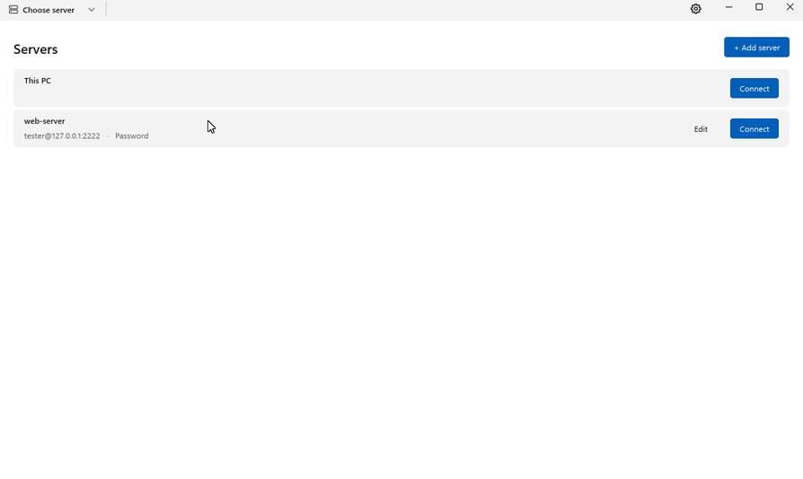
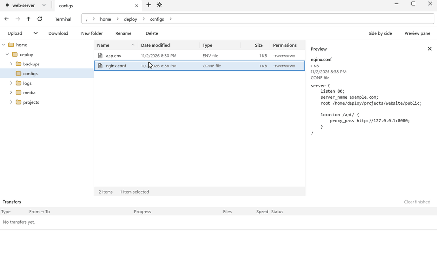
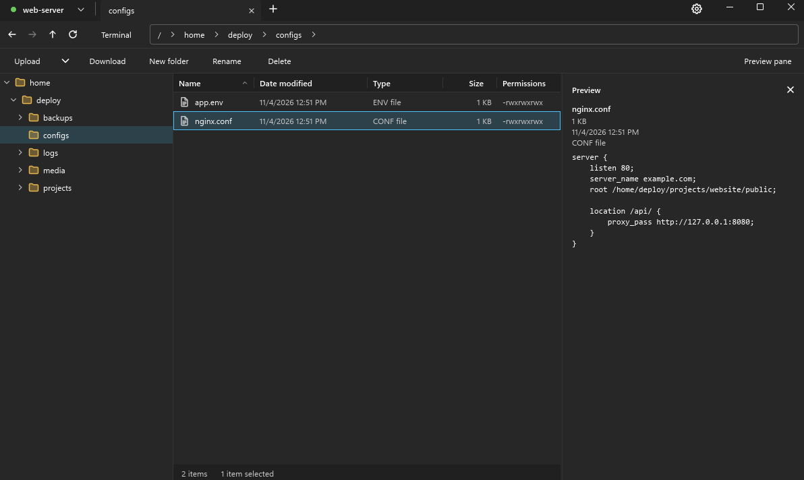

# Folderport

**サーバーを PC のフォルダーのように。**

SSH (SFTP) サーバー、SMB 共有フォルダー、PC のドライブを同じタブで扱える、軽くて速い Windows 用ファイルマネージャーです。

[English](README.md) · [한국어](README.ko.md) · **日本語**

[**⬇ Windows 版をダウンロード**](https://github.com/spilak0203-debug/folderport/releases/latest)

## 機能

- 🗂️ **エクスプローラーのように使える。** フォルダーツリー、並べ替えできる列、階層式のアドレスバー、タブ。
- 🔌 **SSH と SMB をひとつに。** SFTP サーバーと Windows 共有フォルダー (SMB) を 1 つの一覧に保存できます。SSH はパスワードまたはキーファイルで、SMB はユーザー名とパスワードでサインインします。
- 💻 **このPC。** 自分の PC のドライブも同じタブで開き、サーバーとの間でドラッグしてやり取りできます。
- ↔️ **左右に並べて表示。** 1 つのウィンドウを 2 つに分け、2 か所を並べて見ながらドラッグでファイルを移せます。
- ✂️ **切り取り・コピー・貼り付け。** Ctrl+X、Ctrl+C、Ctrl+V や右クリックメニューで、サーバー、タブ、このPC の間を行き来できます。Windows エクスプローラーとの間でも使えます。
- 🧭 **アドレスバーからすぐ移動。** アドレスバーのフォルダー名にポインターを置くとサブフォルダーの一覧が開き、選ぶだけで移動できます。ファイルをドラッグ中にフォルダー名の上で止めるとそのフォルダーへ移動し、そこでドロップするとコピーまたは移動できます。
- 🚀 **サーバー間で直接。** SSH サーバー同士、SSH サーバーと SMB 共有の間で、PC を経由せずにコピーや移動ができます。キーが PC の外に出ることはありません。受け取る側がパスワードでサインインする場合は、そのパスワードを送信元のサーバーに渡すため、そのサーバーの管理者に見られる可能性があります。渡す前に毎回確認するように設定できます。
- ✏️ **その場で編集。** サーバー上のファイルをいつものアプリで開けます。保存するたびに Folderport が自動でアップロードし直します。
- 👀 **プレビュー ウィンドウ。** テキスト、画像、動画 (mkv、avi など。内蔵の mpv で再生) をダウンロードせずに確認できます。
- 📦 **転送パネル。** アップロードとダウンロードごとに進行状況、速度、残り時間を表示し、キャンセルもできます。ふだんは折りたたまれていて、下端にポインターを置くと開き、ピンで固定できます。
- 🖥️ **ターミナル。** アプリの中でサーバーの SSH ターミナルを開けます。
- 🌗 **ライトテーマとダークテーマ**、日本語・English・한국어に対応。
- 🔄 **自動アップデート。** 新しいバージョンは自動でダウンロードされます。準備ができたら **再起動してインストール** をクリックするだけです。

## 左右に並べて表示

2 か所を並べて開き、ファイルをドラッグするだけです。下の例では、300 MB のファイルをこのPC からサーバーへアップロードしています。

  

## ダークテーマ

  

## ダウンロードとインストール

1. [最新リリース](https://github.com/spilak0203-debug/folderport/releases/latest)から `Folderport-Setup-<version>.exe` をダウンロードします。
2. 実行します。現在のユーザーアカウントにだけインストールされるので、管理者権限は必要ありません。
3. Windows SmartScreen に「Windows によって PC が保護されました」と表示されたら、**詳細情報** をクリックしてから **実行** をクリックしてください。インストーラーにまだコード署名がないために表示されます。

**動作環境:** Windows 10 または 11 (64 ビット)。

## サードパーティ ソフトウェア

Folderport は [Slint](https://slint.dev) で作られており、動画の再生には [mpv](https://mpv.io) と [FFmpeg](https://ffmpeg.org) (LGPL) を使っています。ライセンスの全文はアプリと一緒にインストールされます。同梱している mpv と FFmpeg のビルドのソースコードは [`third-party` リリース](https://github.com/spilak0203-debug/folderport/releases/tag/third-party)にあります。

## フィードバック

バグを見つけたときやアイデアがあるときは、[Issue を作成してください](https://github.com/spilak0203-debug/folderport/issues)。
