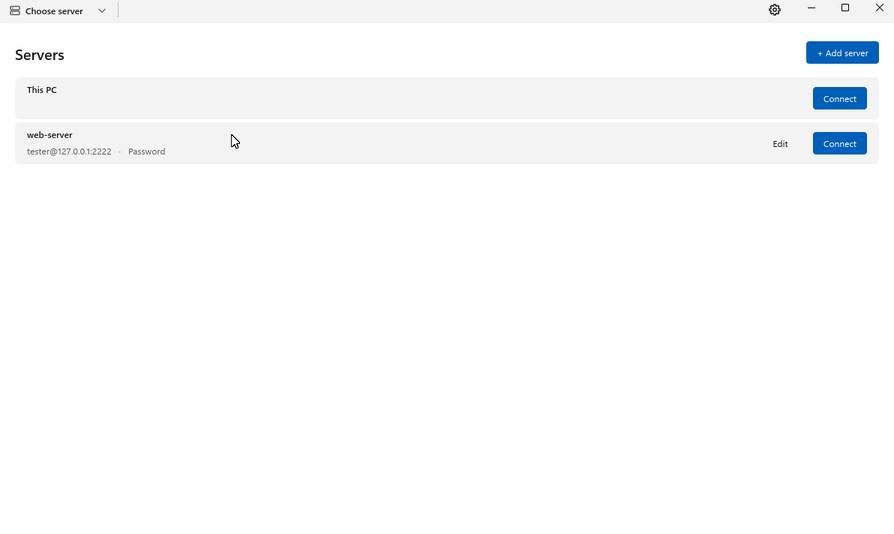
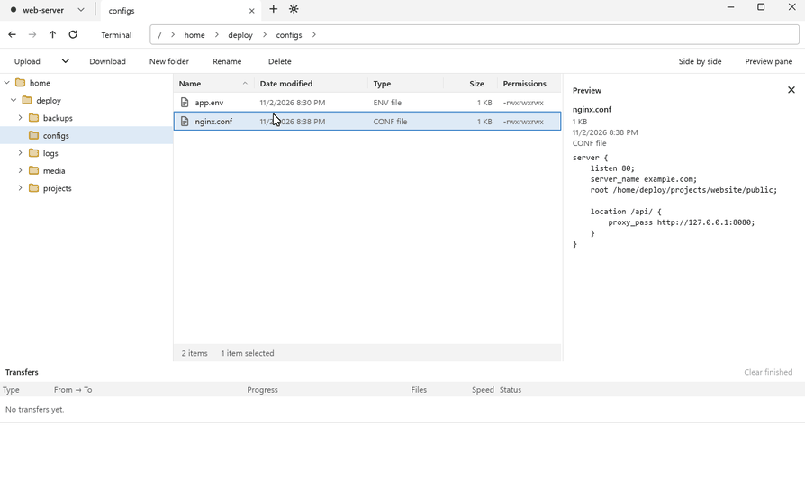
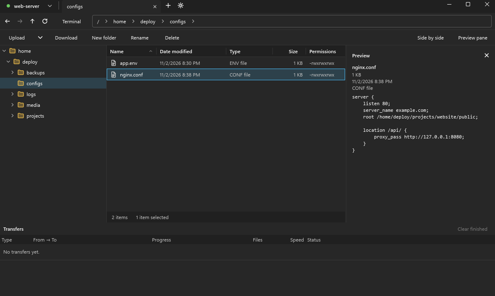

# Folderport

**서버를 내 PC 폴더처럼.**

SSH(SFTP) 서버, SMB 공유 폴더, 내 PC 드라이브를 같은 탭에서 다루는 가볍고 빠른 Windows 파일 관리자입니다.

[English](README.md) · **한국어**

[**⬇ Windows용 다운로드**](https://github.com/spilak0203-debug/ssh-folder-release/releases/latest)

## 기능

- 🗂️ **탐색기처럼 익숙하게.** 폴더 트리, 정렬되는 열, 단계별 주소창, 탭.
- 🔌 **SSH와 SMB를 한곳에서.** SFTP 서버와 Windows 공유 폴더(SMB)를 한 목록에 저장합니다. 비밀번호나 키 파일로 로그인하고, SMB는 Windows 계정으로도 들어갈 수 있습니다.
- 💻 **내 PC.** 내 컴퓨터의 드라이브도 같은 탭에서 둘러보고, 서버와 끌어서 주고받습니다.
- ↔️ **나란히 보기.** 한 창을 둘로 나눠 두 곳을 나란히 보고 서로 끌어다 놓습니다.
- 🧭 **주소창으로 바로 이동.** 주소창의 단계를 누르면 하위 폴더 목록이 펼쳐지고, 골라서 바로 옮겨 갑니다.
- 🚀 **서버끼리 직접.** SSH 서버 사이의 복사·이동이 PC를 거치지 않고 서버끼리 바로 오갑니다. 키는 PC 밖으로 나가지 않습니다.
- ✏️ **그 자리에서 편집.** 서버의 파일을 평소 쓰는 프로그램으로 열고, 저장할 때마다 자동으로 다시 올립니다.
- 👀 **미리 보기 창.** 텍스트, 이미지, 동영상(mkv, avi 등, 내장 mpv로 재생)을 받지 않고 바로 봅니다.
- 📦 **전송 창.** 올리기·받기마다 진행률, 속도, 남은 시간을 보여 주고 취소할 수 있습니다.
- 🖥️ **터미널.** 앱 안에서 서버의 SSH 터미널을 엽니다.
- 🌗 **밝은 테마와 어두운 테마**, 한국어·English·日本語.
- 🔄 **알아서 업데이트.** 새 버전은 스스로 받아 두고, 준비되면 **다시 시작해 설치**를 누르면 됩니다.
- 🪶 **가볍게.** Rust로 처음부터 다시 만들어, 예전 SSH Folder보다 메모리를 약 3분의 1만 씁니다.

## 나란히 보기

두 곳을 나란히 열어 두고 파일을 끌어다 놓으세요. 아래는 300 MB 파일을 내 PC에서 서버로 올리는 모습입니다.

  

## 어두운 테마

  

## 다운로드와 설치

1. [최신 릴리스](https://github.com/spilak0203-debug/ssh-folder-release/releases/latest)에서 `Folderport-Setup-<버전>.exe`를 받습니다.
2. 실행합니다. 지금 사용자 계정에만 설치되므로 관리자 권한이 필요 없습니다.
3. Windows SmartScreen이 "Windows의 PC 보호"를 띄우면 **추가 정보**를 누르고 **실행**을 누르세요. 설치 파일에 아직 코드 서명이 없어서 나오는 창입니다.

**필요한 환경:** Windows 10 또는 11, 64비트.

## SSH Folder를 쓰고 있었다면

Folderport는 **SSH Folder**의 새 버전입니다. SSH Folder가 설치돼 있으면 자동 업데이트로 Folderport로 넘어옵니다. 처음 실행할 때 서버 목록, 저장된 비밀번호, 신뢰한 호스트 키를 그대로 가져옵니다.

실행 파일 이름이 바뀌어 작업 표시줄에 고정해 둔 SSH Folder는 더 이상 열리지 않습니다. Folderport를 다시 고정해 주세요.

## 서드파티 소프트웨어

Folderport는 [Slint](https://slint.dev)로 만들었고, 동영상은 [mpv](https://mpv.io)와 [FFmpeg](https://ffmpeg.org)(LGPL)로 재생합니다. 라이선스 전문은 앱과 함께 설치됩니다. 함께 배포하는 mpv·FFmpeg 빌드의 소스 코드는 [`third-party` 릴리스](https://github.com/spilak0203-debug/ssh-folder-release/releases/tag/third-party)에 있습니다.

## 의견 보내기

버그를 찾았거나 아이디어가 있으면 [이슈를 남겨 주세요](https://github.com/spilak0203-debug/ssh-folder-release/issues).
