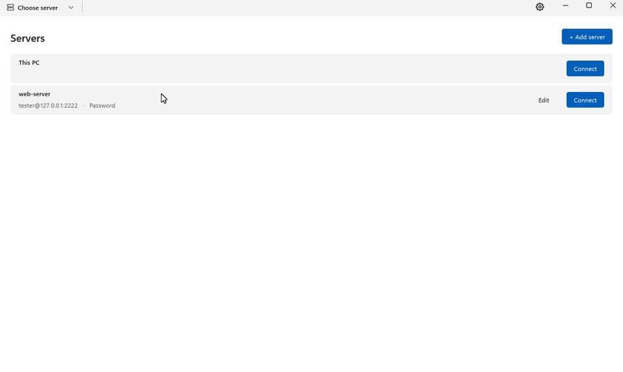
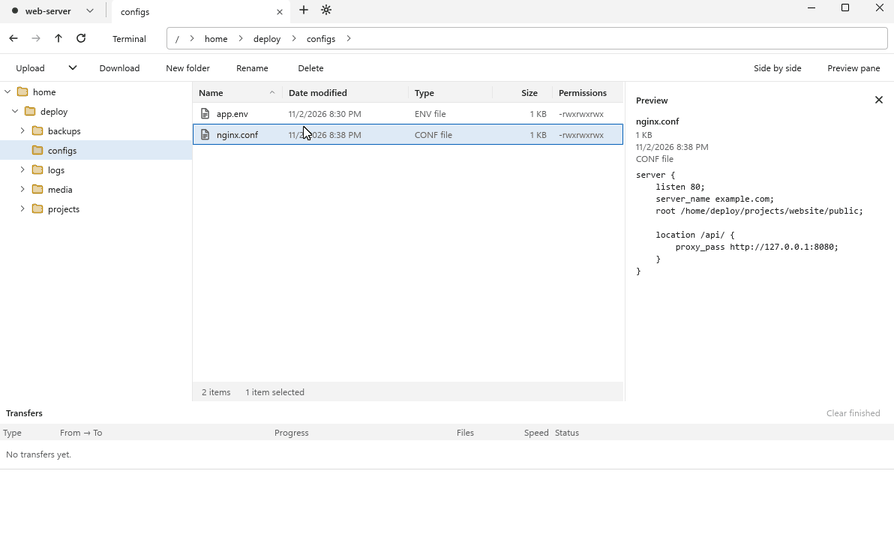
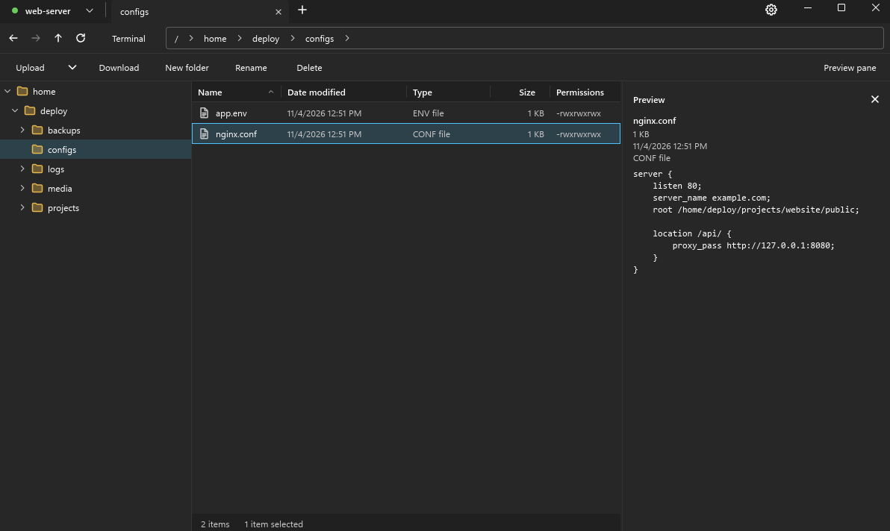

# Folderport

**Browse your servers like folders on your PC.**

A fast, lightweight file manager for Windows that works with SSH (SFTP) servers, SMB shares and your own drives, all in the same tabs.

**English** · [한국어](README.ko.md) · [日本語](README.ja.md)

[**⬇ Download for Windows**](https://github.com/spilak0203-debug/Folderport/releases/latest)

## Features

- 🗂️ **Feels like Explorer.** Folder tree, sortable columns, a breadcrumb address bar and tabs.
- 🔌 **SSH and SMB in one place.** Save SFTP servers and Windows file shares (SMB) in one list. SSH signs in with a password or a key file, SMB with a user name and password.
- 💻 **This PC.** Browse your own drives in the same kind of tab, and drag files between your PC and any server.
- ↔️ **Side by side.** Split a window in two and drag files from one place to the other.
- ✂️ **Cut, copy and paste.** Use Ctrl+X, Ctrl+C and Ctrl+V or the right-click menu between servers, tabs and This PC, and to and from Windows Explorer.
- 🧭 **Jump through the path.** Rest the pointer on a folder name in the address bar to list its subfolders and go straight there. While dragging files, rest on a folder name to go there, or drop on it to copy or move them into it.
- 🚀 **Server to server.** Copy or move files between two SSH servers, or between an SSH server and an SMB share, without passing them through your PC. Your keys never leave your PC. When the receiving side signs in with a password, that password is handed to the sending server, so its administrator could see it. You can choose to be asked first every time.
- ✏️ **Edit in place.** Open a remote file in your usual app. Folderport uploads it again every time you save.
- 👀 **Preview pane.** See text, images and video (mkv, avi and more, played by the built-in mpv) without downloading.
- 📦 **Transfer panel.** Progress, speed and time left for every upload and download, with cancel. It stays folded until you rest the pointer on the bottom edge, and a pin keeps it open.
- 🖥️ **Terminal.** Open an SSH terminal on the server right inside the app.
- 🌗 **Light and dark themes**, and English, 한국어 and 日本語.
- 🔄 **Updates itself.** New versions download on their own. Click **Restart and install** when you are ready.

## Side by side

Open two locations next to each other and drag files across. Here a 300 MB file goes from This PC to the server:

  

## Dark theme

  

## Download and install

1. Download `Folderport-Setup-<version>.exe` from the [latest release](https://github.com/spilak0203-debug/Folderport/releases/latest).
2. Run it. It installs for your user account only, so no administrator rights are needed.
3. If Windows SmartScreen says "Windows protected your PC", click **More info** and then **Run anyway**. The installer is not code-signed yet.

**Requirements:** Windows 10 or 11, 64-bit.

## Third-party software

Folderport is built with [Slint](https://slint.dev) and plays video with [mpv](https://mpv.io) and [FFmpeg](https://ffmpeg.org) (LGPL). The license texts are installed with the app. The source code of the mpv and FFmpeg builds we ship is in the [`third-party` release](https://github.com/spilak0203-debug/Folderport/releases/tag/third-party).

## Feedback

Found a bug or have an idea? [Open an issue](https://github.com/spilak0203-debug/Folderport/issues).
